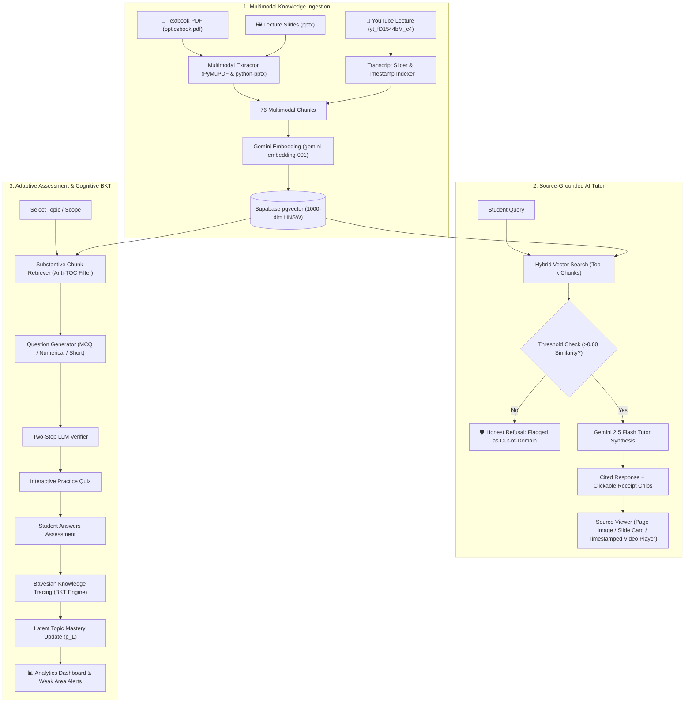

# 🌟 StudyX — Multimodal AI Study Companion & Adaptive Assessment Engine
> **Multimodal AI Hackathon 2026 — Track D: Personalized Tutoring & Adaptive Learning**  
> Built with Gemini 2.5, Supabase pgvector, Bayesian Knowledge Tracing (BKT), and Streamlit.

[](https://www.python.org/)
[](https://streamlit.io/)
[](https://ai.google.dev/)
[](https://supabase.com/)

---

## 💡 Overview & Problem Statement
Students constantly juggle fragmented course materials across textbooks, slide decks, diagrams, and video lectures. Standard LLM study assistants suffer from two fatal flaws:
1. **Ungrounded Hallucinations:** They invent answers or cite non-existent textbook pages and lecture timestamps.
2. **One-Size-Fits-All Quizzing:** They have no internal cognitive model of what the learner actually understands, serving trivial or repetitive questions.

**StudyX** solves this by unifying multimodal course content into an interconnected, **source-grounded knowledge base**, powering:
1. **Multimodal Grounded AI Tutor:** Direct page-level PDF citations, slide cards, and timestamped YouTube video players with an honest refusal guardrail for out-of-domain questions.
2. **Adaptive Cognitive Assessment Engine:** Real-time question generation with anti-trivia filtering, two-step LLM cross-verification, and **Bayesian Knowledge Tracing (BKT)** student modeling.
3. **Transparent Mastery Analytics:** Real-time cognitive mastery curves, streak tracking, and targeted weak-concept revision recommendations.

---

## 🏗️ System Architecture



---

## 🚀 Key Features & Rubric Alignment

### 1. Multimodal Knowledge Base & Grounding (20%)
- **Zero Manual Preprocessing:** Ingests PDF textbooks, PPTX slides, images/diagrams, and YouTube video lectures.
- **Deep-Link Video Seeking:** YouTube chunks are sliced into 35-second chapters. In-app source receipts embed `st.video` seeking directly to the relevant timestamp (`start_time=sec`).
- **Honest Refusal Guardrail:** Evaluates semantic similarity thresholds; off-material queries (e.g. *"How do I bake chocolate chip cookies?"*) are cleanly declined without hallucinations.

### 2. Adaptive Assessment & Verification (15%)
- **Two-Step Question Verification:** Generates and cross-validates questions using source excerpts.
- **Strict Anti-TOC Filtering:** Guaranteed zero trivia on table of contents, book layouts, or section titles — testing only true scientific concepts (Snell's law, refractive index, total internal reflection, Brewster's angle, Huygens' principle).
- **Novelty & Deduplication:** Cosine similarity hashing prevents question repetition across assessment attempts.

### 3. Personalization & BKT Learner Model (20%)
- **Bayesian Knowledge Tracing (BKT):** Tracks latent student mastery per topic with standard parameters ($p(L_0) = 0.30$, $p(T) = 0.15$, $p(S) = 0.10$, $p(G) = 0.25$).
- **Dynamic Difficulty Adaptation:** Recommends Easy ($p < 0.60$), Medium ($0.60 \le p < 0.85$), or Hard ($p \ge 0.85$) challenges based on active student proficiency.
- **Intake & Diagnostic Flow:** Smooth diagnostic baseline for new students with no previous history.

### 4. User Experience & Aesthetics (15%)
- **Glassmorphic Theme:** Dark mode by default with cohesive contrast-safe CSS (`var(--text-color)`, `var(--secondary-background-color)`), responsive cards, and vibrant WCAG-accessible indicators.
- **Streamlit Material Symbols Integration:** Flawless icon rendering for expanders, upload controls, and navigation buttons without font ligature clipping.
- **Interactive Multi-Page Portal:**
  - `app.py`: Overview portal, active streak, and learning snapshot.
  - `pages/1_Upload.py`: Document upload & YouTube lecture ingestion with embedded player preview.
  - `pages/2_Chat.py`: AI Tutor with citation chips and multimedia source receipt viewer.
  - `pages/3_Quiz.py`: Adaptive practice assessments with instant BKT feedback.
  - `pages/4_Dashboard.py`: Cognitive learning curve graphs and weak-concept revision alerts.
  - `pages/5_Knowledge_Base.py`: 38-topic concept hierarchy and interactive chunk explorer.

### 5. System Evaluation & Benchmarking (15%)
- **Simulated Learning Curves:** Verified student simulations across Weak (0.25), Average (0.50), and Strong (0.75) profiles showing empirical mastery gains over 5 sessions (`simulation_chart.png`).
- **Curated Benchmark Suite:** Automated verification across 15 curated benchmark queries with known citations and refusal assertions.

---

## ⚡ Quickstart & Installation

```bash
# 1. Clone repository
git clone https://github.com/shagun12mehta-maker/study-companion.git
cd study-companion

# 2. Set up virtual environment
python3 -m venv venv
source venv/bin/activate
pip install -r requirements.txt

# 3. Configure environment variables (.env)
cp .env.example .env
# Fill in your GEMINI_API_KEY, SUPABASE_URL, and SUPABASE_KEY

# 4. Launch Application
streamlit run app.py
```
Open `http://localhost:8501` in your browser.

---

## 👤 Author
- **Shagun Mehta** ([shagun12mehta-maker](https://github.com/shagun12mehta-maker))

*Track D: Personalized Tutoring & Adaptive Learning — Multimodal AI Hackathon 2026*
